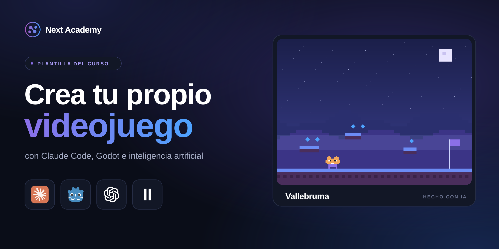
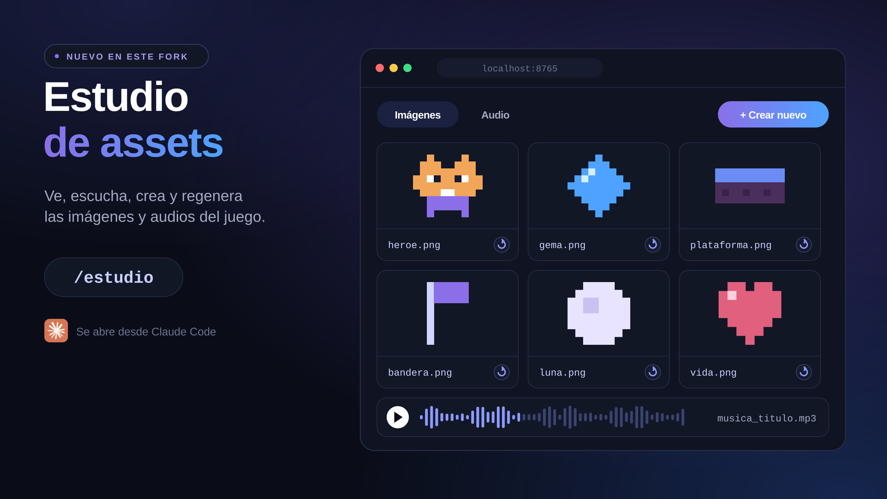
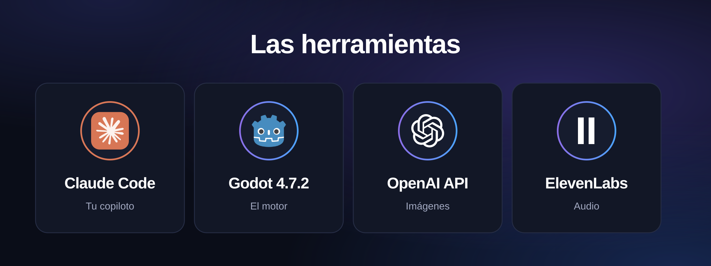
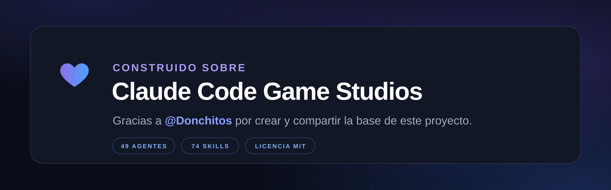

<p align="center">
  
</p>

# Mi primer juego

Plantilla del curso **Crea tu propio videojuego** de **Next Academy**. Con ella construyes un videojuego desde cero usando Claude Code, Godot Engine e inteligencia artificial para el código, el arte, la música y los sonidos.

El repositorio trae la base del proyecto y el Estudio de assets, pero **ningún juego**: el juego lo construyes tú durante el curso.

> Este proyecto es un fork de [**Claude Code Game Studios**](https://github.com/Donchitos/Claude-Code-Game-Studios), creado por [@Donchitos](https://github.com/Donchitos). Toda la estructura de agentes, skills, hooks y reglas viene de ahí. Consulta los [créditos](#créditos).

---

## Qué hay de nuevo en este fork

<p align="center">
  
</p>

- **Estudio de assets.** Un visor y editor local donde ves, escuchas, creas y regeneras todas las imágenes y los audios del juego. Se abre escribiendo `/estudio` en Claude Code y corre en `http://localhost:8765`.
- **Generación de imágenes con la API de OpenAI** y **generación de audio con ElevenLabs**, configuradas con un archivo `.env.local`.
- **Ajustes para el curso de Next Academy**, pensados para seguir las clases paso a paso.

## Herramientas

<p align="center">
  
</p>

| Herramienta | Para qué se usa |
| --- | --- |
| [Claude Code](https://code.claude.com/docs) (o Claude Desktop) | Construir el juego contigo |
| [Godot Engine 4.7.2](https://godotengine.org) | El motor del juego (no se instala: se descarga y se ejecuta) |
| [OpenAI API](https://platform.openai.com) | Generar las imágenes |
| [ElevenLabs](https://elevenlabs.io) | Generar el audio |

## Inicio rápido

1. Clona el repositorio y entra a la carpeta:

   ```bash
   git clone https://github.com/jorgediaz30x/mi-primer-juego.git
   cd mi-primer-juego
   ```

2. Crea un archivo `.env.local` en la raíz del proyecto con tus keys:

   ```env
   OPENAI_API_KEY=tu_key_de_openai
   ELEVENLABS_API_KEY=tu_key_de_elevenlabs
   ```

   > ⚠️ No subas este archivo ni muestres tus keys en pantalla: quien las vea puede gastar tus créditos.

3. Abre Claude Code en la carpeta del proyecto:

   ```bash
   claude
   ```

4. Escribe `/start` para empezar y `/estudio` para abrir el Estudio de assets.

Para la documentación completa de agentes, skills, configuración (`project.yaml`) y hooks, consulta el [README original de Claude Code Game Studios](https://github.com/Donchitos/Claude-Code-Game-Studios#readme).

---

## Créditos

<p align="center">
  
</p>

Este proyecto existe gracias a **[Claude Code Game Studios](https://github.com/Donchitos/Claude-Code-Game-Studios)**, de **[@Donchitos](https://github.com/Donchitos)**. Convierte una sesión de Claude Code en un estudio de videojuegos completo, con agentes especializados, skills para cada fase del desarrollo y un sistema de coordinación inspirado en un estudio real.

Sobre esa base agregamos el Estudio de assets, la integración con OpenAI y ElevenLabs, y los ajustes del curso. Todo el mérito de la arquitectura original es de su autor. ¡Muchas gracias por crearlo y compartirlo con la comunidad! 💜

## Licencia

MIT, igual que el proyecto original. Consulta [LICENSE](LICENSE). Se conserva el aviso de copyright del autor original, como lo exige la licencia.
